  

Ingeniero de telecomunicación especializado en acústica submarina y electrónica marina: sonar, ecosondas, radar y comunicaciones por satélite en buques atuneros en dos océanos. Fuera de horas, construyo herramientas propias con LLMs y *vibecoding* en un servidor que mantengo yo.

## Estaciones

Herramientas que diseñé, programé y mantengo. Cada una declara cómo se accede a ella en el [portal](https://artabrolabs.dev).

| Estación | Qué es | Stack |
|---|---|---|
| [**Magisteria**](https://magisteria.ai) | Plataforma EdTech que genera material educativo con IA | React · TypeScript · Supabase · Claude API |
| [Concello de Ares](https://ares.artabrolabs.dev) | Cuentas municipales 2005–2025 frente a Mugardos, Fene y Cabanas | Python · Chart.js · CONPREL · PLACSP · BDNS |
| [Health Dashboard](https://health.artabrolabs.dev) | Telemetría corporal desde reloj, ciclocomputador y báscula Garmin | Python · D3.js · Leaflet |
| Polymarket Bot | Detección de precios mal calibrados en mercados de predicción | Claude API |
| Smart Farm | Granja inteligente con ESP32 que monto con mi hija | ESP32 · Arduino · IoT |

## Campo

- **Acústica submarina:** ecuación del sonar, propagación con trazado de rayos, ecograma circular de pesca (simulados en el portal con canvas y JavaScript puro).
- **Electrónica marina:** sonares de pesca, ecosondas, radar, satcom.
- **Sistemas:** redes, servidores propios, despliegue continuo desde GitHub.

## Contacto

[admin@artabrolabs.dev](mailto:admin@artabrolabs.dev) · [artabrolabs.dev](https://artabrolabs.dev) · [LinkedIn](https://www.linkedin.com/in/gonzalogarciamartinez)

Ares · Golfo Ártabro · 43.4289°N 8.2447°W
